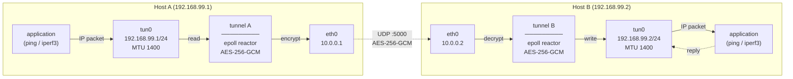
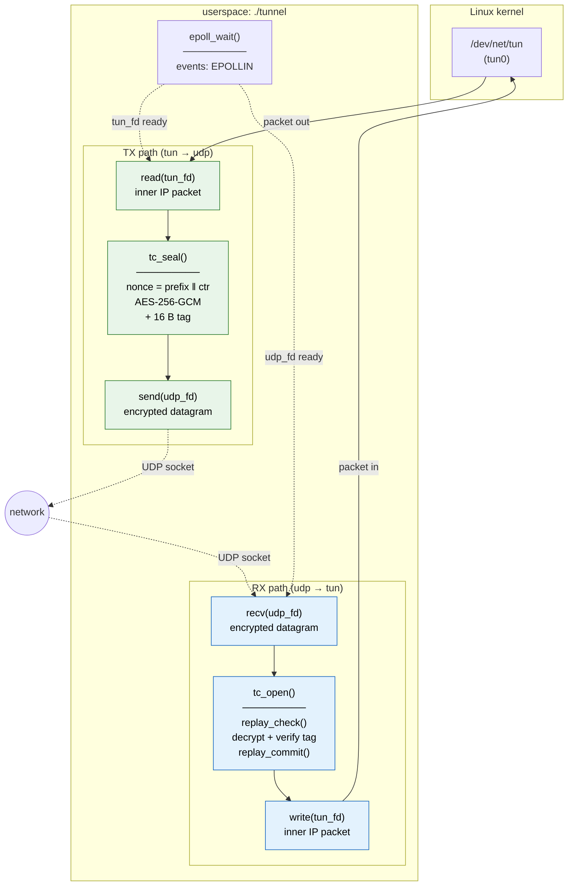
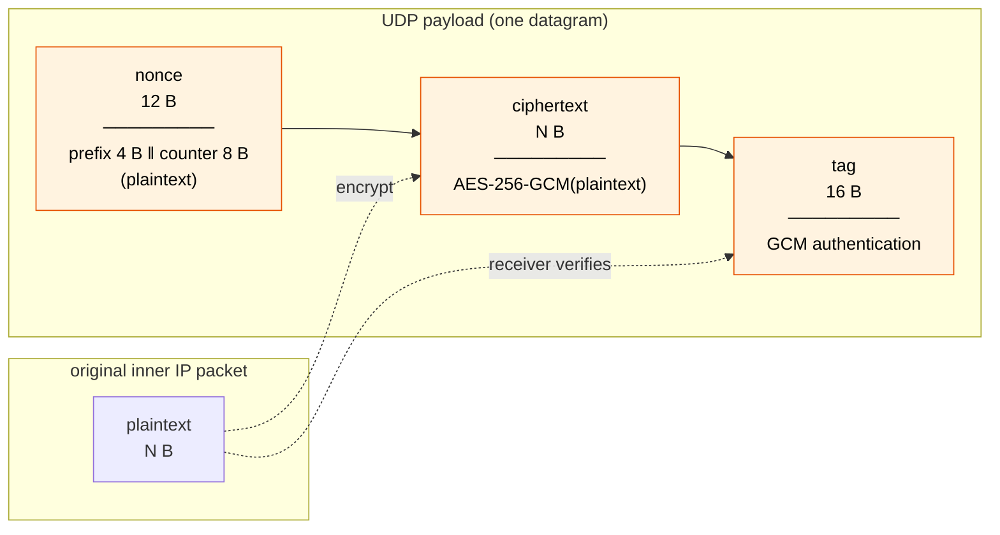
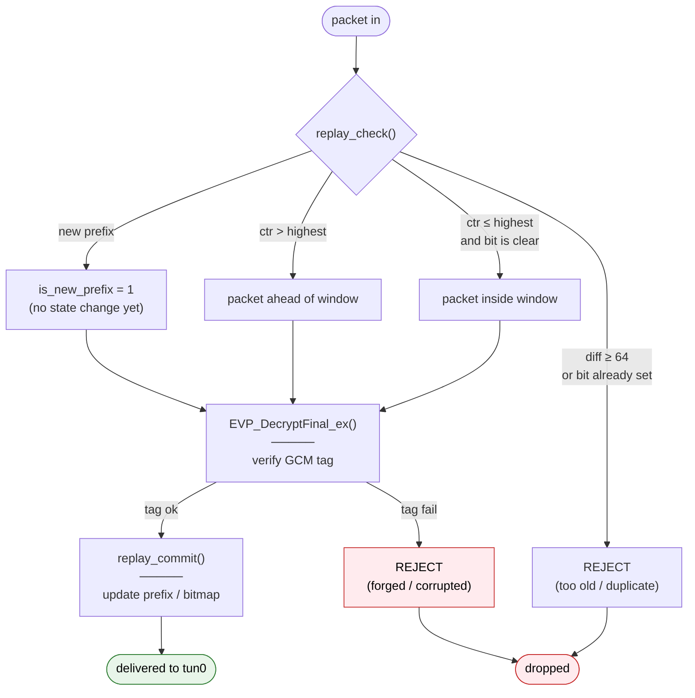

# udp-tunnel

A minimal point-to-point IP tunnel over UDP with authenticated encryption.
Packets from a TUN interface are encrypted with **AES-256-GCM** and forwarded
over UDP, the peer decrypts them and injects them back into its own TUN
interface. Think of it as a tiny IPSec/WireGuard-inspired lab.



## Features

- **TUN interface** created directly via `ioctl(TUNSETIFF)` on `/dev/net/tun`.
- **Single-threaded event loop** based on `epoll`.
- **AES-256-GCM** authenticated encryption via the OpenSSL EVP API.
- **Nonce construction** `random_prefix || counter_be`. Collision-resistant across process restarts, monotonic within a session (same scheme WireGuard uses).
- **Replay protection** with a 64-bit sliding window.
- **State commits only after authentication**. No side effects from forged packets.
- **Graceful shutdown** on `SIGINT`/`SIGTERM` via `sigaction` (no `SA_RESTART`, so `epoll_wait` returns `EINTR` immediately).
- **Centralized cleanup**. All resources released on any exit path.
- **Unit tests** for the crypto module under `-fsanitize=address,undefined`.
- **Integration test** that spins up two network namespaces, runs two tunnel instances, and verifies `ping` over `tun0` while sniffing the wire to confirm the traffic is encrypted UDP.

## Requirements

- Linux (any modern kernel is fine).
- `gcc` or `clang` with C11 support.
- `libssl-dev` (OpenSSL ≥ 1.1.0).
- For tests only: `iproute2`, `iputils-ping`, optionally `tcpdump`.

On Debian/Ubuntu:

```bash
sudo apt install build-essential libssl-dev iproute2 iputils-ping tcpdump
```

## Build

```bash
make            # release build with -O2 -Wall -Wextra -Wpedantic
make debug      # same, but -O0 -g3 and LOG_LEVEL=DEBUG
make clean
```

## Usage

### Generate a 32-byte AES key (do this once, share it out-of-band with the peer)

```bash
./tunnel --genkey > key.bin
```

### On host A

```bash
sudo ip tuntap add dev tun0 mode tun
sudo ip addr add 192.168.99.1/24 dev tun0
sudo ip link set tun0 up mtu 1400

sudo ./tunnel \
    --tun     tun0 \
    --listen  10.0.0.1:5000 \
    --peer    10.0.0.2:5000 \
    --key     key.bin
```

### On host B (mirror)

```bash
sudo ip tuntap add dev tun0 mode tun
sudo ip addr add 192.168.99.2/24 dev tun0
sudo ip link set tun0 up mtu 1400

sudo ./tunnel \
    --tun     tun0 \
    --listen  10.0.0.2:5000 \
    --peer    10.0.0.1:5000 \
    --key     key.bin
```

### Then

```bash
ping 192.168.99.2
```

10.0.0.X is the "physical" network between the two hosts; 192.168.99.X is the inner (tunnel) network.

> **Why `mtu 1400`?** Each inner packet gets wrapped in our header (12 B nonce + 16 B tag) plus outer UDP/IP headers (28 B). With `mtu 1500` on the outer link, the inner MTU must shrink to stay under the path MTU.

## Testing

### Unit tests

```bash
make test         # 8 tests, plain build
make test-san     # same, under ASan + UBSan
```

Covers roundtrip, ciphertext tamper, tag tamper, replay (single + ordered), wrong key, edge cases (NULL, small buffers, empty payload).

### Integration test

Requires root for `ip netns`:

```bash
sudo ./scripts/test.sh
```

The script:

1. creates ns1/ns2 namespaces with a veth pair between them,
2. generates a fresh key,
3. starts one tunnel instance in each namespace,
4. pings 192.168.99.1 → 192.168.99.2 through tun0,
5. sniffs veth with tcpdump to confirm traffic is UDP,
6. checks logs for [ERR] entries,
7. cleans up everything via trap EXIT.

Expected output ends with:

```
  ok all checks passed
--- PASS ---
```

## Architecture

The tunnel is a **single-threaded reactor**. Two file descriptors are
registered with `epoll`, and events from them are handled one at a time.

| FD       | Role |
|----------|------|
| `tun_fd` | `/dev/net/tun` — inner IP packets in and out |
| `udp_fd` | `SOCK_DGRAM` socket, `connect()`ed to the peer |



### Wire format

Each inner IP packet becomes one UDP datagram with the following layout:



- **Nonce** = prefix (4 B random, per session) || counter (8 B, big-endian). The counter is monotonic and never reused within a session. The random prefix avoids nonce collisions across process restarts.
- **AEAD** = AES-256-GCM, 16-byte tag, no associated data.
- **Overhead** = 28 bytes on top of the inner packet (12 B nonce + 16 B tag). This is why the inner MTU is set to 1400 - the outer link can still carry it under the standard 1500-byte path MTU.
- **Replay window** = 64 packets, tracked with a single uint64_t bitmap.

### Replay protection

The replay window is a two-phase design. State is mutated only after the packet passes GCM authentication:



Two functions, with a strict split of responsibilities:

- **`replay_check()`**. Returns whether the packet is fresh and whether the source prefix is new. It may look at the
window, but never touches it.
- **`replay_commit()`**. Mutates the window only after `EVP_DecryptFinal_ex()` succeeds. If a forged packet slips past
`replay_check()`, its counter is never marked as seen, so a subsequent legitimate packet with the same counter is not incorrectly dropped.

### Shutdown

Signals are installed with `sigaction()` and without `SA_RESTART`. The handler sets a volatile `sig_atomic_t` stop flag and returns.

Removing `SA_RESTART` is what makes the shutdown prompt: `epoll_wait()` returns immediately with `EINTR`, the loop checks stop, and the program exits through the common cleanup path. If `SA_RESTART` were set, the reactor would block on `epoll_wait()` until the next packet arrived, which could be minutes.

## Limitations / future work

This is deliberately a small project. Things that would make it production-worthy:

- **Key exchange.** Currently a pre-shared key. Real systems use X25519 + HKDF (and, ideally, a Noise-like handshake with forward secrecy).
- **Keepalive + dead peer detection.** A real tunnel sends periodic keepalive packets so NAT mappings do not expire, and marks the
  peer dead after a timeout. Without this the tunnel appears alive long after the peer has gone away.
- **MTU handling.** Today the inner MTU must be set manually (`mtu 1400` in the examples). A production tunnel would probe the path MTU, expose the inner
  MTU as a runtime parameter, and react to ICMP "fragmentation needed" by shrinking it.
- **Batched I/O (`sendmmsg` / `recvmmsg`).** Currently one syscall per packet. Batching up to 1024 packets per syscall is a small change that measurably
  improves throughput on high-packet-rate links.
- **Multi-peer support.** A hashmap keyed by source address, one crypto context per peer.
- **Stateless cookie / retry** to mitigate UDP flood DoS.
- **Rate-limited warnings.** The `[WRN]` on auth failure currently fires on every forged packet; a token bucket would keep logs quiet under attack.
- **Metrics.** Counters for `tx_packets`, `rx_packets`, `auth_fails`, `replay_drops`.
- **Privilege separation.** Open the TUN fd as root, then `setuid(nobody)`.
- **`io_uring` variant** for comparison against the `epoll` reactor.